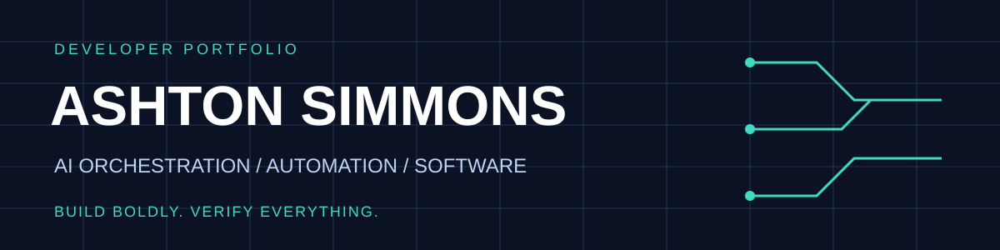
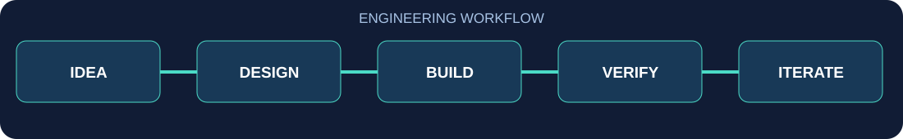

<div align="center">

# ASHTON SIMMONS
### AI Orchestration • Automation • Software Engineering • Product Building

**Building ambitious systems, one verifiable milestone at a time.**

[](#-featured-projects)
[](#-the-master-key--ai-orchestration--governance)
[](#-how-i-build)

**Designing human-governed AI workflows and practical software — with evidence before claims.**

[**RECRUITER QUICK START →**](docs/recruiter.md) · [**PROJECT STATUS →**](docs/project-status.md) · [**FULL PORTFOLIO →**](docs/portfolio.md)

</div>

---

## 👋 About me

I'm **Ashton Simmons**, a builder working across **AI orchestration, automation, developer tooling, financial software, and consumer applications**.

My projects explore a common question: **How do you turn a big idea into a system that's useful, understandable, testable, and safe to operate?**

I'm interested in remote opportunities in **AI implementation, workflow automation, solutions engineering, technical customer success, and early-career software development**.

> **My philosophy:** Make the system ambitious. Make the claims precise. Make the results verifiable.

## 🚀 Featured projects

**Explore the work:** [Recruiter quick start](docs/recruiter.md) · [Portfolio overview](docs/portfolio.md) · [Project maturity dashboard](docs/project-status.md)

> **Portfolio transparency:** These projects are in different stages of development. Their source repositories are currently private. The descriptions below distinguish implemented checkpoints from plans; no production deployments are implied.

### 🧠 [THE MASTER KEY — AI orchestration & governance](docs/master-key.md)

**Founder-directed AI operations and command-center architecture.**

A system designed to coordinate AI roles, models, tools, missions, approvals, and evidence while keeping consequential decisions under explicit human control.

**Engineering themes:** mission lifecycles · permission boundaries · model/tool registries · evidence and audit trails · independent review · spending controls · operator interfaces.

**Recruiter-friendly deep dive:** [How I investigated and verified MK's security and persistence tests →](docs/mk-engineering-case-study.md) · [Architecture diagram](docs/mk-architecture.md) · [90-second demo plan](docs/mk-demo-storyboard.md)

**Why it matters:** Delegation is only useful when operators can understand, verify, and control what automated systems do.

**Verified local checkpoint (Oct. 12, 2026):** 146 security and 174 domain/persistence test executions passed; one skipped. Results used five test-only corrections in an isolated worktree, not the pristine commit or full suite. [Scope and limitations](docs/master-key.md) · [Evidence index](docs/evidence.md).

**Status:** In development. Private source; no claim of a production autonomous workforce. Sanitized demonstrations planned.

---

### 💸 [TipFlow — financial software for tipped workers](docs/tipflow.md)

**A financial operating-system concept for people who earn tips.**

Explores software and workflows designed around the financial realities of tipped work.

**Engineering themes:** financial product design · user-centered workflows · practical business software.

**Status:** In development. Feature-level demonstrations pending verification.

---

### 📈 [Bubba Bucks — quantitative research infrastructure](docs/bubba-bucks.md)

**AI-assisted quantitative research and market-data infrastructure.**

Documented research workflows include universes/watchlists, historical data requests, pagination, normalized datasets, data-quality checks, resumable ingestion, synthetic data generation, and research exports.

**Engineering themes:** Python · data pipelines · validation · reproducibility · CLI tooling · operational guardrails.

**Safety boundary:** Research and observation only. No live trading, profitability claims, or autonomous trade execution.

**Status:** Research infrastructure in development.

---

### 🏆 [TourneyNest / TournamentOS — sports-family planning](docs/tourneynest.md)

**A family-execution app concept for youth and travel sports.**

Designed around the real-world loop: **Schedule → Review → Prepare → Pack → Leave → Play → Reset → Remember**.

**Engineering themes:** SwiftUI architecture · Supabase-oriented backend design · privacy boundaries · data modeling · platform integration planning.

**Status:** Structural checkpoints documented. Native iOS testing and some Apple integrations remain deferred.

---

### 🧰 [ApplyForge — local-first job application copilot](docs/applyforge.md)

**Tools for understanding opportunities and managing the application process.**

Explores job analysis, tailored application workflows, and opportunity tracking with a local-first approach.

**Engineering themes:** workflow automation · AI-assisted productivity · local-first software.

**Status:** In development. Public demo details pending review.

---

### ✨ [Merriwisp — upcoming project showcase](docs/merriwisp.md)

A separate project in my development portfolio. A verified description and visuals will follow an implementation review.

**Status:** Private repository; public overview pending.

## 🧪 Try an interactive automation prototype

[**🚀 TRY THE LIVE AUTOMATION LAB →**](https://ashtoncodes316.github.io/AshtonCodes316/automation-lab/) · [Source and limitations](docs/automation-lab/README.md)

Explore approval gates, blocked workflows, draft preparation, and a local JSON evidence receipt. This is a **static, rule-based educational demo**, not a live AI integration. GitHub Pages is enabled; the founder confirmed the live page opened and the approval-gate scenarios worked on October 12, 2026. No independent browser verification has been performed.

## 🧩 Interactive customer onboarding workflow

[**TRY WORKFLOW STUDIO →**](https://ashtoncodes316.github.io/AshtonCodes316/workflow-studio/) · [Source and honest limitations](docs/workflow-studio/README.md)

A second browser-only prototype: fictional onboarding intake, readiness validation, blockers, simulated owner assignment, human sign-off, and downloadable JSON receipts. **Founder-reported check (Oct. 12, 2026):** The live page opened and the readiness/handoff walkthrough worked. No independent browser test was performed.

## 💼 AI automation for real business workflows

[**Explore business-focused automation use cases →**](docs/business-automation.md)

See how the portfolio's project concepts connect to support triage, operational handoffs, data validation, and workflow tracking. The examples distinguish proposed applications from implemented and verified capabilities.

**Career-ready skills overview:** [Technical skills, job alignment, and learning roadmap →](docs/technical-skills-career.md)

## 🛠️ Engineering focus

| Area | What I build and explore |
|---|---|
| **AI orchestration** | Missions, role-based agents, approval gates, evidence-based workflows |
| **Automation** | Repeatable processes, workflow tooling, operational checks |
| **Backend & tooling** | Python-oriented tools, CLIs, tests, data handling |
| **Product engineering** | Consumer apps, financial workflows, application architecture |
| **Responsible systems** | Permission boundaries, auditability, privacy, human oversight |

*Tools and technologies vary by project. Future case studies will separate implemented features from planned integrations.*

## 🔍 How I build




```text
IDEA → DEFINE THE WORKFLOW → DESIGN THE BOUNDARIES
     → IMPLEMENT → TEST → VERIFY → DOCUMENT → ITERATE
```

I care about the work behind the demo: readable documentation, meaningful checkpoints, tests, and a clear explanation of what a system **can** and **cannot** do.

## 🤝 Let's connect

I'm interested in **remote opportunities** spanning AI implementation, automation, technical solutions, and software/product development.

**GitHub:** [github.com/AshtonCodes316](https://github.com/AshtonCodes316)  
**Project case studies:** [Six-project portfolio](docs/portfolio.md)  
**Master Key deep dive:** [Architecture, governance and current limits](docs/master-key.md)  
**Engineering evidence:** [Evidence index](docs/evidence.md) · [Runnable MK governance example](examples/mk-governance/README.md)

<div align="center">

---

### BUILD BOLDLY. VERIFY EVERYTHING.
*Ashton Simmons · Developer & AI Systems Builder*

</div>
