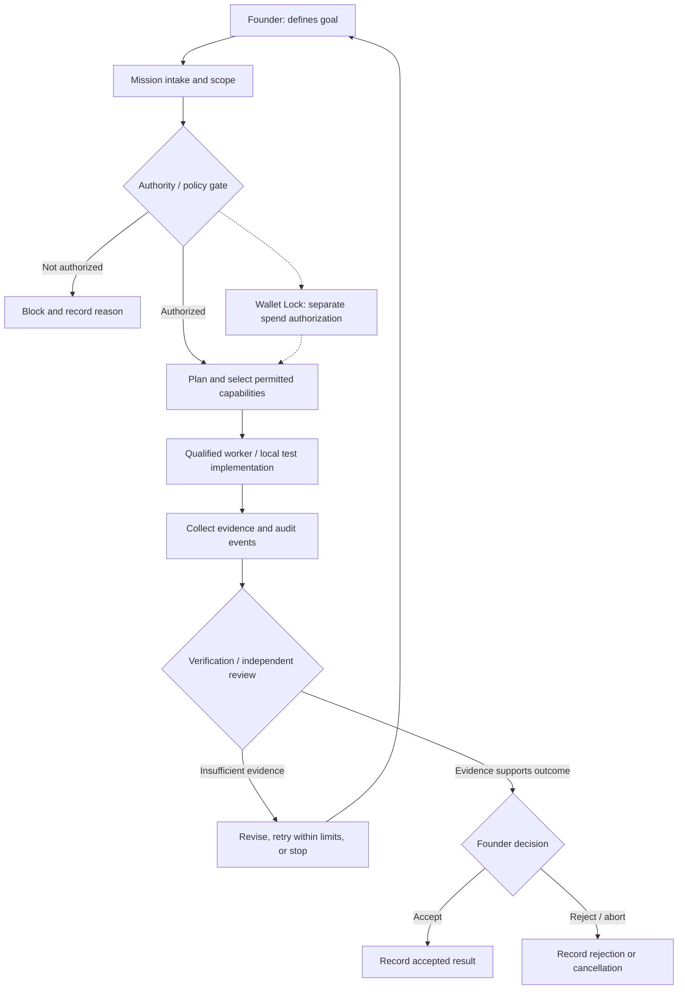

# Master Key — Governed Mission Architecture

**Portfolio illustration · October 2026**

This is a **conceptual system flow**, not proof that a live multi-agent workforce or paid AI provider is connected.

## What the diagram means

- **Mission:** A bounded work order with explicit status and scope.
- **Permission gate:** Determines whether requested actions are allowed.
- **Worker:** May be simulated or local; a qualified live AI worker is **not** implied.
- **Evidence:** Execution artifacts and logs that can be examined separately from claims.
- **Verification:** Checks whether evidence supports the reported result.
- **Founder gate:** Keeps consequential approval and spending authority with the operator.

## Verified scope

On October 12, 2026, a detached local Windows test worktree reported **146 passing security tests** and **174 passing domain/persistence tests**, with **one skip**. Five test files were adjusted for schema expectations and fixture configuration; production files were unchanged. This is **not** the result of running the pristine commit, all 3,834 collected tests, or an independent audit.

[Master Key case study](master-key.md) · [Evidence index](evidence.md) · [Profile](../README.md)
